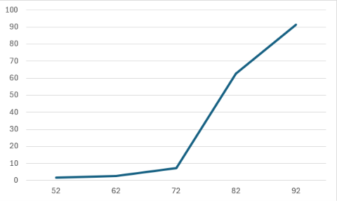
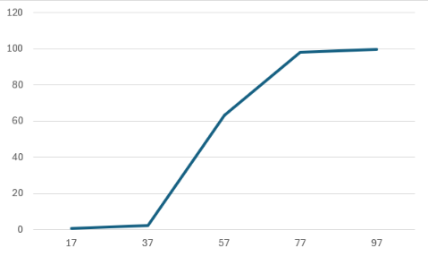

## Комп'ютерні системи імітаційного моделювання
## СПм-25-1, **Ткаченко Тетяна Андріївна**
### Лабораторна робота №**1**. Опис імітаційних моделей та проведення обчислювальних експериментів

 

### Варіант 5, модель у середовищі NetLogo:
[Fire Simple Extension 2](https://www.netlogoweb.org/launch#http://www.netlogoweb.org/assets/modelslib/IABM%20Textbook/chapter%203/Fire%20Extensions/Fire%20Simple%20Extension%202.nlogo)

 

### Вербальний опис моделі:
Модель імітує поширення лісової пожежі та демонструє, як щільність дерев і сила вітру впливають на її поширення. Вогонь починається на лівому краю лісу та поширюється на сусідні дерева в чотирьох напрямках: на північ, схід, південь і захід. Вітер збільшує ймовірність займання в напрямку свого руху та зменшує її в протилежному напрямку. Модель дає змогу дослідити, за яких умов пожежа може охопити більшу частину лісу та досягти його протилежного краю.

### Керуючі параметри:
- **density** визначає щільність дерев у лісі, тобто частку території, зайняту деревами.
- **probability-of-spread** визначає ймовірність поширення вогню від одного дерева до сусіднього.
- **south-wind-speed** визначає силу та напрямок вітру вздовж осі північ–південь. Додатне значення відповідає південному вітру, від’ємне — північному.
- **west-wind-speed** визначає силу та напрямок вітру вздовж осі схід–захід. Додатне значення відповідає західному вітру, від’ємне — східному.

### Внутрішні параметри:
- **initial-trees**. Початкова кількість дерев у лісі, яка визначається під час налаштування моделі та зберігається для подальшого використання.

### Показники роботи системи:
- кількість дерев, охоплених пожежею, тобто кількість ділянок, на яких вогонь уже виник або які згоріли.
- частка лісу, охоплена пожежею, відносно початкової кількості дерев.
- досягнення вогнем правого краю лісу, що свідчить про поширення пожежі через весь лісовий масив.

### Примітки:
Щільність дерев і напрямок вітру суттєво впливають на поширення пожежі. За низької щільності дерев вогонь може швидко припинити поширення через відсутність сусідніх дерев. Вітер може як сприяти поширенню пожежі, так і перешкоджати йому.

### Недоліки моделі:
Модель не враховує всі реальні фактори, які впливають на лісову пожежу, наприклад вологість дерев, температуру повітря та рельєф місцевості.

 

## Обчислювальні експерименти
 
### 1. Вплив щільності дерев на відсоток згорілого лісу
Досліджується залежність відсотка згорілого лісу (percent burned) від початкової щільності дерев (density).
Експерименти проводяться зі значеннями щільності від 52% до 92% із кроком 10%, усього 5 симуляцій.
Інші керуючі параметри мають значення за замовчуванням:
- **probability-of-spread**: 57%
- **south-wind-speed**: 25
- **west-wind-speed**: 25

<table>
<thead>
<tr><th>Щільність дерев у %</th><th>Відсоток згорілого лісу %</th></tr>
</thead>
<tbody>
<tr><td>52</td><td>1,8</td></tr>
<tr><td>62</td><td>2,7</td></tr>
<tr><td>72</td><td>7,4</td></tr>
<tr><td>82</td><td>62,7</td></tr>
<tr><td>92</td><td>91,3</td></tr>
</tbody>
</table>

 
Графік наочно показує, що зі збільшенням щільності дерев відсоток згорілого лісу зростає. За щільності 52–72% пожежа охоплює незначну частину лісу, тоді як за щільності 82% згорає вже 62,7% дерев, а за 92% аж 91,3%. Отже, висока щільність дерев сприяє поширенню пожежі та збільшенню площі згорілого лісу.

### 2. Дослідження впливу ймовірності поширення вогню
Досліджується залежність відсотка згорілого лісу (percent burned) від ймовірності поширення вогню (probability-of-spread), зазначеної перед початком симуляції.
Експерименти проводяться при значеннях ймовірності поширення вогню від 17% до 97%, з кроком 20%, усього 5 симуляцій.
Інші керуючі параметри мають значення за замовчуванням:
- **density**: 82%
- **south-wind-speed**: 25
- **west-wind-speed**: 25

<table>
<thead>
<tr><th>Ймовірність поширення вогню у %</th><th>Відсоток згорілого лісу у %</th></tr>
</thead>
<tbody>
<tr><td>17</td><td>0,9</td></tr>
<tr><td>37</td><td>2,2</td></tr>
<tr><td>57</td><td>63,2</td></tr>
<tr><td>77</td><td>98,3</td></tr>
<tr><td>97</td><td>99,6</td></tr>
</tbody>
</table>

 
Графік наочно показує, що зі збільшенням ймовірності поширення вогню відсоток згорілого лісу зростає. За ймовірності 17–37% пожежа охоплює незначну частину лісу, тоді як за ймовірності 57% згорає вже 63,2% лісу. За значень 77% і 97% згорає майже весь ліс, а саме 98,3% та 99,6% відповідно. Отже, збільшення ймовірності поширення вогню сприяє швидшому та масштабнішому поширенню пожежі.
